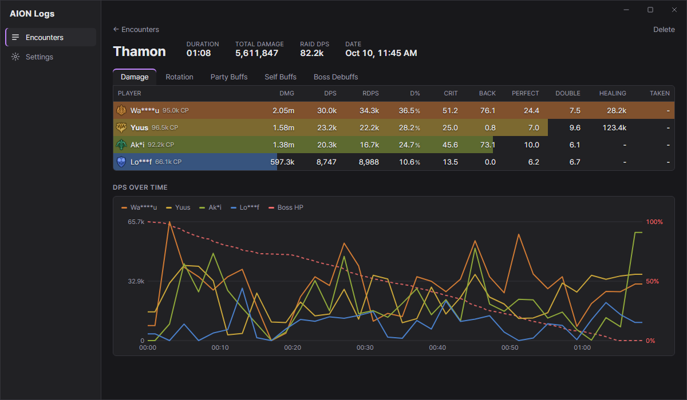
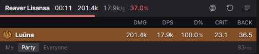
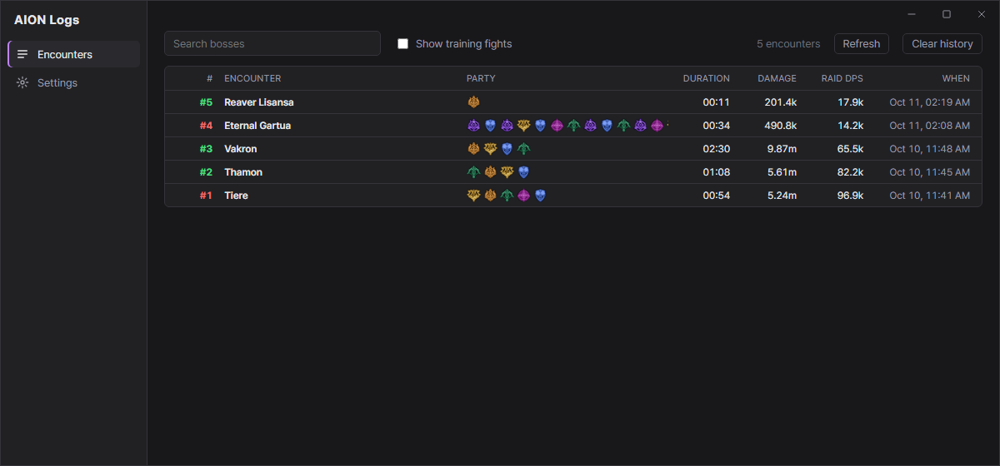
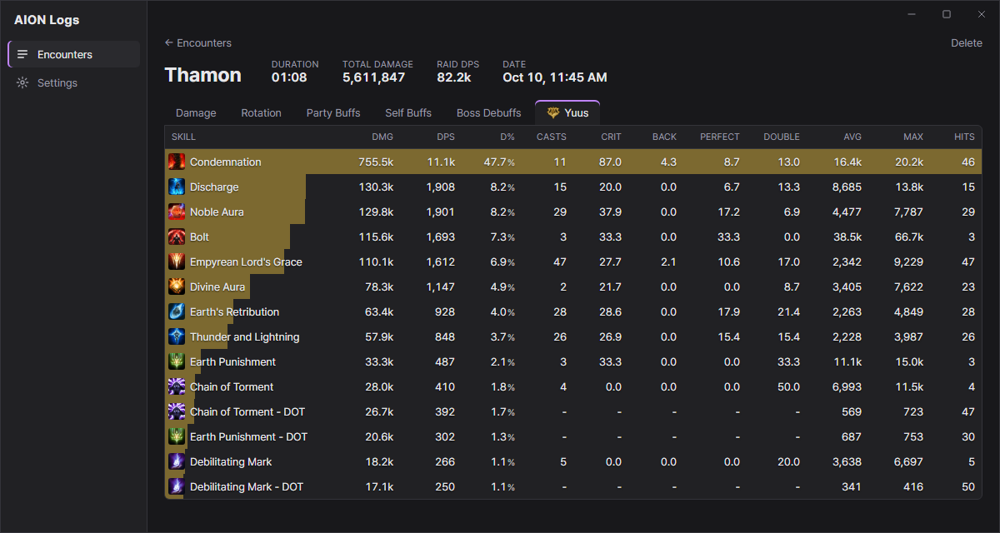
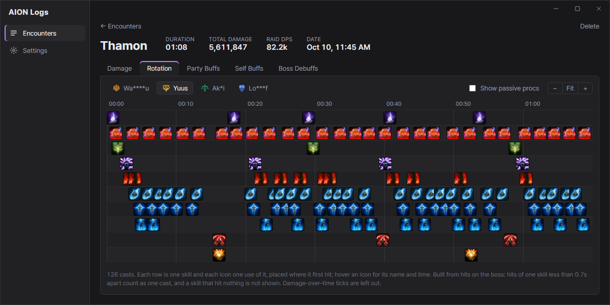
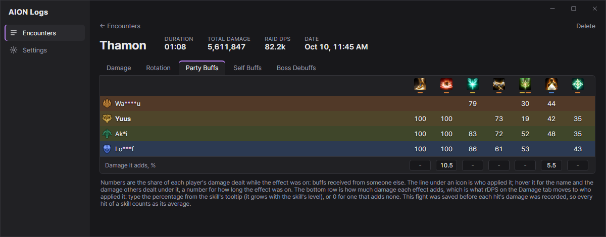

# AION Logs

A DPS meter for AION 2 in the style of [LOA Logs](https://github.com/snoww/loa-logs):
a small overlay that shows the boss fight you are in, and a logs window that
keeps every encounter so you can go back through the damage, each player's
skills, their rotation, the buffs and how the fight went over time.



## Install

1. Download `AION-Logs_x.y.z_x64.msi` from the
   [latest release](https://github.com/Hauske/AION-Logs/releases/latest) and run it.
2. Windows shows "Windows protected your PC", because the installer is not
   signed. Click **More info**, then **Run anyway**.
3. Start **AION Logs** as administrator. It reads the game's network traffic,
   and Windows only allows that for an administrator.
4. The first time, it offers to install [Npcap](https://npcap.com), the driver
   it reads the traffic with. Say yes and go through Npcap's installer.

Windows 10 or 11. Start the meter before you log in to a character: the game
sends player names when you enter the world, and a meter started later shows
numbers in their place until you change zone.

### Updates

When the meter starts, and every hour after, it looks for a newer release here
on GitHub. If there is one, an **Update now** button appears in the Logs
window, and a dot on the meter's Logs button. Nothing installs until you click
it: then it downloads the installer, checks it against the release's checksum,
installs it and reopens. Settings → **Check now** looks on demand.

## What it shows

### The meter



Sits on top of the game and only shows boss fights. Per player: damage, DPS,
share of the damage, crit and back attack rates. The header has the fight's
time, the boss's health and how long it has left to live at the rate its
health is falling. Drag its right edge to resize it; switch between yourself,
your party and everyone at the bottom.

| Shortcut | Does |
|---|---|
| `Ctrl+Alt+Up` | Hide or show the meter |
| `Ctrl+Alt+R` | Reset: save the fight in progress and start over |

Both can be changed in Settings.

### Encounters



Every boss fight is saved when it ends, numbered green for a kill and red for
a wipe. Open one for:

- **Damage**: each player's damage, DPS, rDPS, crit, back, perfect and double
  rates, healing and damage taken, and a chart of DPS and the boss's health
  over the fight.
- **A player's skills**: click a player for damage, casts, average and biggest
  hit per skill.

  

- **Rotation**: the order each player used their skills in.

  

- **Party Buffs, Self Buffs, Boss Debuffs**: for every effect, how much of
  each player's damage was dealt while it was on, and who applied it.

  

### rDPS

DPS counts a hit for whoever landed it. rDPS moves the part of a hit that a
buff added to whoever applied the buff, so a support shows what they brought
to the party and a damage dealer what they did on their own. The raid's total
stays the same.

It is an estimate. The game does not say how much a buff adds, and that grows
with the skill's level, so the percentages are yours to set: in the Party
Buffs and Boss Debuffs tabs, the bottom row has a box under each effect. A few
start filled in with the skills' level 1 tooltips; an effect with no number
moves nothing.

## How it works

The game client and the server talk over the network. AION Logs listens to
that traffic on your own computer through Npcap, picks out the combat messages
(who hit what, with which skill, for how much, which buffs went on and off)
and adds them up. It does not read or change the game's memory or files, and
it sends nothing to the game.

Everything it records stays on your computer, in
`%APPDATA%\com.aionlogs.meter`. The only connections it makes are to GitHub
(to look for a newer version), to the game's own image server (skill icons)
and to npcap.com (only if Npcap is missing and you agree to install it).

Reading the game's traffic is not something NCSOFT has said it allows. AION
Logs is not affiliated with or endorsed by NCSOFT; use it at your own risk.

## Credits

- **[A2Tools DPS Meter](https://github.com/taengu/A2Tools-DPS-Meter)** by
  taengu. AION Logs is a fork of it: the packet capture, the decoding of the
  game's messages and the combat bookkeeping (everything in `src-tauri/`) are
  A2Tools' work, with small changes. If this meter is useful to you, that
  project is the reason it exists.
- **[LOA Logs](https://github.com/snoww/loa-logs)** by snoww, the Lost Ark
  meter the interface is modelled on: the layout of the meter and the
  encounter pages, and the idea of rDPS as it is shown here.

## Licence

GPL-3.0, like A2Tools DPS Meter. See [LICENSE](LICENSE).

## Building it yourself

Needs [Rust](https://rustup.rs/), the Visual Studio C++ Build Tools and Node.js 18+.

```bash
npm install
npm run tauri build
```

The installer is written to `src-tauri/target/release/bundle/msi/`, the
program itself to `src-tauri/target/release/aion-logs.exe`. `release.ps1`
builds a release: the installer and the `latest.json` that installed copies
read to find it.

### Working on the interface

`npm run dev` serves the interface in a browser at http://localhost:1420
without the game. It answers from saved fights copied into `ui/mock/` (from
`%APPDATA%\com.aionlogs.meter\history`). `?view=main` is the meter and
`?view=history` the logs window.

### Layout

- `ui/` the interface (Svelte)
- `src-tauri/` the backend (Rust, from A2Tools)
- `src/data/` game data tables (skills, buffs, NPCs)
- `docs/`, `packaging/`, `log-service/` A2Tools' material, kept so its updates
  merge cleanly
